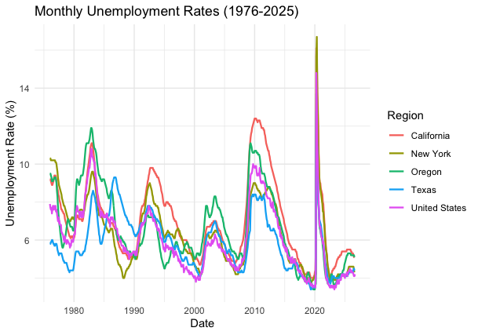
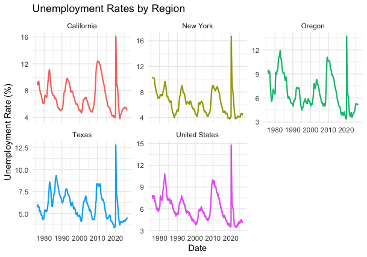
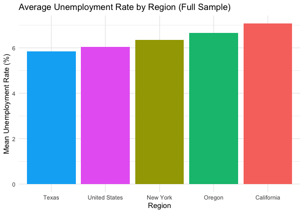
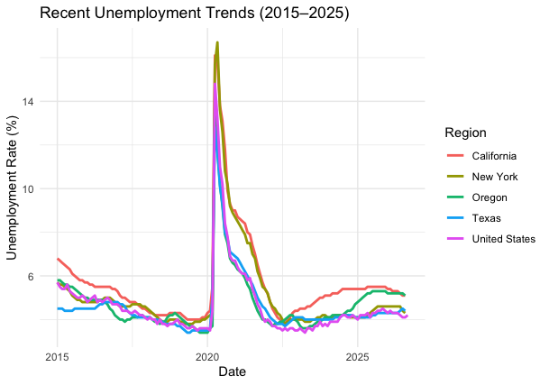

---
title: "Problem Set 2"
author: "Jackson Woolfolk"
date: today
format:
  html:
    toc: true
    embed-resources: true
---

GitHub repo: \<https://github.com/Jackson-Woolfolk/ec422_ps2_woolfolk\>

\`\`\`{r} #\| include: false library(tidyverse) library(tidyquant) library(knitr)

## 

## Read data

unemp_raw \<- read_rds("data/unemp_raw.rds")

## \## Wrangling steps

unemp \<- unemp_raw \|\> rename(unemployment_rate = price) \|\> mutate( region = case_when( symbol == "UNRATE" \~ "United States", symbol == "ORUR" \~ "Oregon", symbol == "CAUR" \~ "California", symbol == "TXUR" \~ "Texas", symbol == "NYUR" \~ "New York" ) )

unemp \<- unemp \|\> arrange(region, date) \|\> group_by(region) \|\> mutate( unemployment_rate = replace( unemployment_rate, date == as.Date("2025-10-01"), unemployment_rate\[date == as.Date("2025-09-01")\] ) ) \|\> ungroup() \|\> mutate(unemployment_rate_change = unemployment_rate - lag(unemployment_rate)) \|\> ungroup()

unemp_recent \<- unemp \|\> filter(date \>= as.Date("2015-01-01"))

unemp_summary \<- unemp \|\> group_by(region) \|\> summarize( mean_rate = mean(unemployment_rate, na.rm = TRUE), min_rate = min(unemployment_rate, na.rm = TRUE), max_rate = max(unemployment_rate, na.rm = TRUE) )

unemp_recent_summary \<- unemp_recent \|\> group_by(region) \|\> summarize( mean_rate = mean(unemployment_rate, na.rm = TRUE), min_rate = min(unemployment_rate, na.rm = TRUE), max_rate = max(unemployment_rate, na.rm = TRUE) )

unemp_no_2020 \<- unemp \|\> filter(format(date, "%Y") != "2020")

unemp_top_increases_no_covid \<- unemp_no_2020 \|\> slice_max(unemployment_rate_change, n = 5, with_ties = TRUE)

unemp_top_decreases_no_covid \<- unemp_no_2020 \|\> slice_min(unemployment_rate_change, n = 5, with_ties = TRUE)

## \## Visualization

library(ggplot2)

library(forcats)

```{r}
#| echo: false
#| fig-cap: "Description of plot 1"
p1 <- ggplot(unemp, aes(x = date, y = unemployment_rate, color = region)) +
  geom_line(linewidth = 0.8) +
  labs(
    title = "Monthly Unemployment Rates (1976-2025)",
    x = "Date",
    y = "Unemployment Rate (%)",
    color = "Region"
  ) +
  theme_minimal()

p1
```



```{r}
#| echo: false
#| fig-cap: "Description of plot 2"
p2 <- ggplot(unemp, aes(x = date, y = unemployment_rate, color = region)) +
  geom_line(linewidth = 0.8) +
  facet_wrap(~ region, scales = "free_y") +
  labs(
    title = "Unemployment Rates by Region",
    x = "Date",
    y = "Unemployment Rate (%)",
    color = "Region"
  ) +
  theme_minimal() + theme(legend.position = "none")

p2
```



```{r}
#| echo: false
#| fig-cap: "Description of plot 3"
p3 <- ggplot(unemp_summary, aes(x = fct_reorder(region, mean_rate), y = mean_rate, fill = region)) +
  geom_col(show.legend = FALSE) +
  labs(
    title = "Average Unemployment Rate by Region (Full Sample)",
    x = "Region",
    y = "Mean Unemployment Rate (%)"
  ) +
  theme_minimal()

p3
```



```{r}
#| echo: false
#| fig-cap: "Description of plot 4"
p4 <- ggplot(unemp_recent, aes(x = date, y = unemployment_rate, color = region)) +
  geom_line(linewidth = 1) +
  labs(
    title = "Recent Unemployment Trends (2015–2025)",
    x = "Date",
    y = "Unemployment Rate (%)",
    color = "Region"
  ) +
  theme_minimal()

p4
```



I chose to look at trends in state unemployment rates against each other, and used recent data so I could visualize the state's reactions to the Covid-19 pandemic. This helps distinguish what states were able to recover faster than others after the pandemic caused a massive spike in unemployment.
